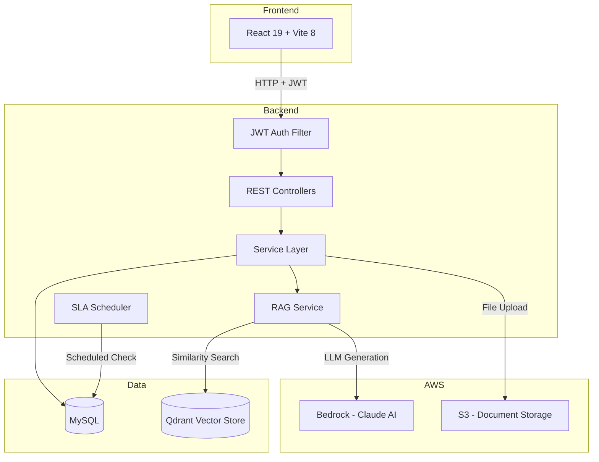

# IncidentPilot

AI-powered incident management platform that learns from past outages to help resolve future ones faster.

## Problem

When production goes down, on-call engineers waste 30–60 minutes searching through scattered runbooks, old Slack threads, and past postmortems. IncidentPilot builds an AI-powered knowledge layer over your incident history — when a new incident hits, it surfaces similar past incidents and resolution steps instantly using RAG (Retrieval-Augmented Generation).

## Key Features

- **Incident Lifecycle Management** — State machine enforcing `TRIGGERED → ACKNOWLEDGED → INVESTIGATING → RESOLVED → POSTMORTEM` with validation that rejects invalid transitions
- **AI-Powered Resolution Suggestions** — Uses AWS Bedrock (Claude) to analyze incidents and suggest resolution strategies based on similar past events
- **RAG Pipeline** — Semantic search over past incidents and uploaded postmortems using Qdrant vector store + LLM-generated summaries
- **Real-time Dashboard** — Interactive charts (status distribution, severity breakdown), aggregate stats, and MTTR tracking
- **Activity Timeline** — Append-only event log per incident for status changes, engineer comments, and actions taken during an outage
- **Knowledge Base** — Upload postmortems and runbooks (stored in S3) that get embedded into the vector store for future incident resolution
- **SLA Monitoring** — Scheduled breach detection with severity-dependent thresholds (P1: 15min ack / 4hr resolve)
- **Audit Trail** — Immutable log of all incident creates, status transitions, and SLA breaches with user attribution
- **JWT Authentication** — Stateless auth with role-based access control (Admin, Engineer, Viewer)
- **Rate Limiting** — Token-bucket rate limiter on AI endpoints (20 req/min, 100 req/hr per user)
- **Circuit Breaker** — Resilience4j circuit breaker on all AI calls with graceful fallback

## Architecture



### Request Flow

1. Frontend sends request with JWT in `Authorization: Bearer` header
2. `JwtAuthenticationFilter` validates the token and sets the Spring Security context
3. `SecurityConfig` checks role-based permissions (VIEWER/ENGINEER/ADMIN)
4. Controller delegates to the service layer for business logic
5. Service layer orchestrates: database operations → vector embedding → audit logging
6. For AI endpoints: `RagService` queries Qdrant for similar content, then calls Bedrock to generate a resolution suggestion

### Graceful Degradation

The AI pipeline is designed to work even when external services are down:

| Qdrant | Bedrock | Behavior |
|--------|---------|----------|
| Up | Up | Vector matches + AI-generated resolution suggestion |
| Down | Up | AI suggestion based on incident title/description alone |
| Up | Down | Similar matches returned, no AI summary |
| Down | Down | Static fallback message, `aiAvailable: false` |

## Tech Stack

| Layer | Technology |
|---|---|
| Backend | Java 20, Spring Boot 3.4.1, Maven |
| Security | Spring Security, JWT (jjwt 0.12.6), BCrypt |
| Database | MySQL 8+ with Flyway migrations |
| AI/LLM | Spring AI 1.0.0, AWS Bedrock (Claude Haiku 4.5 via Converse API) |
| Vector Store | Qdrant (semantic similarity search) |
| Storage | AWS S3 (document uploads) |
| Resilience | Resilience4j (circuit breaker), Bucket4j (rate limiting) |
| Frontend | React 19, Vite 8, Tailwind CSS 4, React Router 7, Recharts 3, Axios |
| Testing | JUnit 5, Mockito, AssertJ, MockMvc, Testcontainers, Playwright |

## Prerequisites

- **Java** 20+
- **Maven** 3.9+
- **Node.js** 22+ and npm 10+
- **MySQL** 8.0+
- **AWS Account** with Bedrock access and an S3 bucket
- **Qdrant** (optional — app starts without it, AI features work in degraded mode)
- **Docker** (optional — for integration tests via Testcontainers)

## Getting Started

### 1. Database Setup

Create a MySQL database:

```sql
CREATE DATABASE incidentpilot;
```

### 2. AWS Configuration

IncidentPilot uses the [AWS Default Credential Provider Chain](https://docs.aws.amazon.com/sdk-for-java/latest/developer-guide/credentials-chain.html). Configure credentials via any of:

- `~/.aws/credentials` file (recommended for local development)
- Environment variables (`AWS_ACCESS_KEY_ID`, `AWS_SECRET_ACCESS_KEY`)
- IAM instance role (for EC2/ECS deployment)

Required AWS services:
- **Bedrock** — model access enabled for Claude Haiku 4.5 in your region
- **S3** — a bucket for document uploads (default: `incident-pilot-docs`)

### 3. Environment Variables

| Variable | Description | Default |
|---|---|---|
| `MYSQL_HOST` | MySQL hostname | `localhost` |
| `MYSQL_PORT` | MySQL port | `3306` |
| `MYSQL_DB` | Database name | `incidentpilot` |
| `MYSQL_USER` | Database username | `root` |
| `MYSQL_PASSWORD` | Database password | — |
| `AWS_REGION` | AWS region for Bedrock and S3 | `us-east-1` |
| `BEDROCK_CHAT_MODEL` | Bedrock model inference profile ID | `in.anthropic.claude-haiku-4-5-20251001-v1:0` |
| `JWT_SECRET` | Base64-encoded HMAC-SHA256 key (production) | dev key provided |

> **Note**: The `BEDROCK_CHAT_MODEL` must be an [inference profile ID](https://docs.aws.amazon.com/bedrock/latest/userguide/inference-profiles.html), not a raw model ID. Raw model IDs don't work with Bedrock's on-demand throughput.

### 4. Run the Backend

```bash
cd backend
mvn spring-boot:run
```

The API starts at `http://localhost:8080`.

Flyway automatically runs database migrations on first startup.

### 5. Run the Frontend

```bash
cd frontend
npm install
npm run dev
```

The UI starts at `http://localhost:5173`. API calls are proxied to the backend automatically via Vite's dev server.

### 6. Optional: Start Qdrant

To enable vector similarity search:

```bash
docker run -p 6333:6333 -p 6334:6334 qdrant/qdrant
```

Then remove `QdrantVectorStoreAutoConfiguration` from the `spring.autoconfigure.exclude` list in `application.properties`.

## API Reference

All endpoints except `/api/auth/**` require a JWT token in the `Authorization: Bearer <token>` header.

### Authentication

| Method | Endpoint | Auth | Description |
|--------|----------|------|-------------|
| `POST` | `/api/auth/register` | Public | Register a new user |
| `POST` | `/api/auth/login` | Public | Login and receive JWT |

**Register:**

```bash
curl -X POST http://localhost:8080/api/auth/register \
  -H "Content-Type: application/json" \
  -d '{"username": "jsmith", "password": "securepass123", "email": "j@example.com"}'
```

```json
{
  "token": "eyJhbGciOiJIUzI1NiJ9...",
  "username": "jsmith",
  "role": "ENGINEER"
}
```

**Login:**

```bash
curl -X POST http://localhost:8080/api/auth/login \
  -H "Content-Type: application/json" \
  -d '{"username": "jsmith", "password": "securepass123"}'
```

### Incidents

| Method | Endpoint | Role | Description |
|--------|----------|------|-------------|
| `POST` | `/api/incidents` | ENGINEER, ADMIN | Create incident |
| `GET` | `/api/incidents` | VIEWER+ | List incidents (supports `?status=` and `?severity=` filters) |
| `GET` | `/api/incidents/stats` | VIEWER+ | Aggregate stats (totals, MTTR, breakdowns) |
| `GET` | `/api/incidents/{id}` | VIEWER+ | Get incident by ID |
| `PATCH` | `/api/incidents/{id}/status` | ENGINEER, ADMIN | Transition incident status |
| `GET` | `/api/incidents/{id}/similar` | VIEWER+ | AI-powered similar incidents + resolution suggestion |
| `GET` | `/api/incidents/{id}/audit` | VIEWER+ | Audit trail for an incident |

**Create Incident:**

```bash
curl -X POST http://localhost:8080/api/incidents \
  -H "Authorization: Bearer <token>" \
  -H "Content-Type: application/json" \
  -d '{
    "title": "Payment gateway timeout",
    "description": "Stripe API returning 504s for 10% of requests",
    "severity": "P1_CRITICAL",
    "serviceName": "payment-service",
    "assignee": "jsmith"
  }'
```

```json
{
  "id": 1,
  "title": "Payment gateway timeout",
  "description": "Stripe API returning 504s for 10% of requests",
  "severity": "P1_CRITICAL",
  "status": "TRIGGERED",
  "assignee": "jsmith",
  "serviceName": "payment-service",
  "createdAt": "2025-01-15T10:30:00",
  "updatedAt": "2025-01-15T10:30:00",
  "resolvedAt": null
}
```

**Update Status (state machine enforced):**

```bash
curl -X PATCH http://localhost:8080/api/incidents/1/status \
  -H "Authorization: Bearer <token>" \
  -H "Content-Type: application/json" \
  -d '{"status": "ACKNOWLEDGED"}'
```

**Get AI-Powered Similar Incidents:**

```bash
curl http://localhost:8080/api/incidents/1/similar \
  -H "Authorization: Bearer <token>"
```

```json
{
  "similarMatches": [
    {
      "content": "Incident: Payment timeout\nService: payment-service...",
      "source": "incident:5",
      "score": 0.87
    }
  ],
  "resolutionSuggestion": "1. Check Stripe status page for outages\n2. Increase connection pool timeout to 30s\n3. Enable retry with exponential backoff",
  "aiAvailable": true
}
```

### Incident Lifecycle

```
TRIGGERED → ACKNOWLEDGED → INVESTIGATING → RESOLVED → POSTMORTEM
```

Each transition is enforced by a state machine. Invalid transitions (e.g. `TRIGGERED → RESOLVED`) are rejected with HTTP 400.

### Timeline

| Method | Endpoint | Role | Description |
|--------|----------|------|-------------|
| `POST` | `/api/incidents/{id}/timeline` | ENGINEER, ADMIN | Add a timeline event |
| `GET` | `/api/incidents/{id}/timeline` | VIEWER+ | Get incident timeline |

**Add Timeline Event:**

```bash
curl -X POST http://localhost:8080/api/incidents/1/timeline \
  -H "Authorization: Bearer <token>" \
  -H "Content-Type: application/json" \
  -d '{
    "type": "COMMENT",
    "message": "Checked DB connection pool — at 100% capacity",
    "author": "jsmith"
  }'
```

Event types: `STATUS_CHANGE` (auto-generated), `COMMENT`, `ACTION`

### Documents (Knowledge Base)

| Method | Endpoint | Role | Description |
|--------|----------|------|-------------|
| `POST` | `/api/documents` | ADMIN | Upload a postmortem/runbook (.txt, .md) |
| `GET` | `/api/documents` | VIEWER+ | List uploaded documents |

**Upload Document:**

```bash
curl -X POST http://localhost:8080/api/documents \
  -H "Authorization: Bearer <token>" \
  -F "file=@postmortem-2024-01.md"
```

Upload pipeline: file → S3 storage → text extraction → Qdrant vector embedding → searchable by RAG.

## AI & RAG Architecture

IncidentPilot uses a custom `BedrockChatModel` that wraps the AWS Bedrock Converse API directly, bypassing Spring AI 1.0.0's broken auto-configuration (which references a class that only exists in Spring AI 2.0.0+).

### How RAG Works

1. **Indexing**: When an incident is created or a document is uploaded, its text is embedded into the Qdrant vector store
2. **Retrieval**: When a user requests similar incidents, the incident's title + description is used as a query against the vector store (top-5 results, 0.5 similarity threshold)
3. **Generation**: Retrieved context + the new incident details are sent to Claude via Bedrock, which generates 2–3 actionable resolution steps

### Configuration

```properties
# AWS region — must have Bedrock access enabled
spring.ai.bedrock.aws.region=${AWS_REGION:us-east-1}

# Inference profile ID (not raw model ID)
spring.ai.bedrock.converse.chat.options.model=${BEDROCK_CHAT_MODEL:in.anthropic.claude-haiku-4-5-20251001-v1:0}

# Qdrant vector store (optional — excluded from auto-config by default)
spring.ai.vectorstore.qdrant.host=localhost
spring.ai.vectorstore.qdrant.port=6334
spring.ai.vectorstore.qdrant.collection-name=incident-pilot
```

## Testing

### Unit Tests (72 tests)

```bash
cd backend
mvn test
```

| Test Class | Tests | Coverage Area |
|---|---|---|
| `AuthControllerTest` | 5 | Registration, login, validation |
| `IncidentControllerTest` | 8 | CRUD, filters, stats, status transitions |
| `TimelineEventControllerTest` | 4 | Timeline add/list |
| `DocumentControllerTest` | 3 | Upload, list |
| `IncidentServiceTest` | 12 | Business logic, state machine |
| `RagServiceTest` | 5 | RAG search, AI fallback, embedding |
| `TimelineEventServiceTest` | 5 | Events, status change recording |
| `AuditServiceTest` | 3 | Audit logging, user resolution |
| `AuthServiceTest` | 4 | Register, login, duplicate checks |
| `DocumentServiceTest` | 4 | Upload pipeline |
| `SlaServiceTest` | 4 | SLA breach detection |
| `JwtServiceTest` | 5 | Token generation, validation, expiry |
| `IncidentStatusTest` | 5 | State machine transitions |
| `RateLimitFilterTest` | 5 | Rate limiting |

### Integration Tests (requires Docker)

```bash
cd backend
mvn verify
```

Runs against a real MySQL instance via Testcontainers.

### E2E Tests (Playwright)

```bash
cd frontend
npx playwright install chromium
npx playwright test
```

Covers auth flows, dashboard, incident CRUD, filters, and document uploads.

## Project Structure

```
backend/
├── src/main/java/com/incidentpilot/
│   ├── config/         # BedrockChatModel, BedrockConfig, WebConfig, RateLimitFilter
│   ├── security/       # SecurityConfig, JwtService, JwtAuthenticationFilter
│   ├── controller/     # AuthController, IncidentController, TimelineEventController, DocumentController
│   ├── service/        # IncidentService, RagService, AuditService, SlaService, S3Service, DocumentService
│   ├── model/          # JPA entities (Incident, TimelineEvent, User, Document, AuditLog) + enums
│   ├── dto/            # Request/response DTOs with validation
│   ├── repository/     # Spring Data JPA repositories
│   └── exception/      # GlobalExceptionHandler + domain exceptions
├── src/main/resources/
│   ├── application.properties          # Dev config
│   ├── application-prod.properties     # Production config (env vars only)
│   └── db/migration/                   # Flyway SQL migrations (V1, V2)
└── src/test/java/                      # 72 unit tests + integration tests

frontend/
├── src/
│   ├── api/            # Axios client with JWT interceptor
│   ├── components/     # Sidebar, StatusBadge, SeverityBadge, StatsCard, SimilarIncidents, ProtectedRoute
│   ├── context/        # AuthContext (JWT + user state)
│   ├── pages/          # Dashboard, IncidentList, IncidentDetail, CreateIncident, LoginPage, RegisterPage, DocumentUpload
│   ├── App.jsx         # Router setup with protected routes
│   └── main.jsx        # Entry point
├── e2e/                # Playwright E2E tests
├── vite.config.js      # Vite + Tailwind + API proxy
└── package.json
```

## Security Considerations

- **Stateless JWT authentication** — no server-side sessions; tokens expire after 24 hours
- **BCrypt password hashing** — passwords are never stored in plain text
- **Role-based access control** — three tiers: ADMIN > ENGINEER > VIEWER
- **No credential exposure** — AWS credentials resolved via Default Credential Provider Chain, never hardcoded
- **Input validation** — size limits, format patterns, and null checks on all endpoints via Jakarta Validation
- **Error sanitization** — the catch-all exception handler returns generic messages to prevent stack trace leaks
- **Rate limiting** — AI endpoints are rate-limited per user to prevent abuse
- **Circuit breaker** — prevents cascading failures when Bedrock or Qdrant is unreachable
- **CORS** — restricted to local development origins (localhost:5173–5175)

## SLA Thresholds

| Severity | Acknowledge | Resolve |
|----------|-------------|---------|
| P1 Critical | 15 minutes | 4 hours |
| P2 High | 30 minutes | 12 hours |
| P3 Medium | 2 hours | 48 hours |
| P4 Low | 8 hours | 7 days |

Breaches are logged as audit events and appear in the incident audit trail.

## Current Limitations

- **Single-instance deployment** — rate limit buckets are in-memory and reset on restart
- **No WebSocket/SSE** — dashboard requires manual refresh to see new incidents
- **Text-only documents** — knowledge base only supports `.txt` and `.md` files (no PDF parsing)
- **No user management UI** — users are created via API; no admin panel for role assignment
- **SLA breach detection is advisory** — logs breaches as audit events but doesn't auto-escalate

## Roadmap

- [x] Incident domain with state machine
- [x] Incident timeline (event log)
- [x] API filtering and statistics
- [x] React frontend dashboard
- [x] Spring Security & JWT authentication
- [x] AI-powered similar incident search (RAG) with AWS Bedrock
- [x] Knowledge base with S3 storage and vector embedding
- [x] SLA monitoring and breach detection
- [x] Audit trail
- [x] Rate limiting and circuit breaker
- [x] Flyway database migrations
- [x] Production profile with env-var configuration
- [ ] Docker Compose and CI/CD pipeline
- [ ] Notification system (Slack/email on SLA breach)
- [ ] Multi-tenant support

## License

This project is for educational and portfolio purposes.
